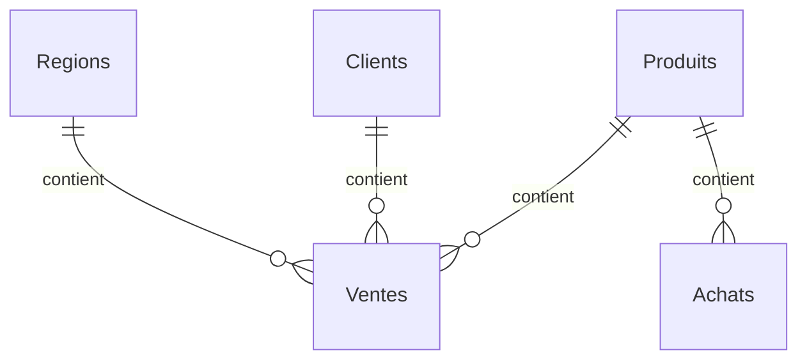

# Business Intelligence — Analyse Commerciale Ventes & Achats

> Projet BI complet : pipeline ETL Power Query (M), modèle dimensionnel en étoile, 29 mesures DAX et rapports interactifs Power BI pour le pilotage commercial.

## Problématique

Une direction commerciale doit analyser ventes et achats à partir de sources hétérogènes (fichiers Excel par année, par site, par canal). Sans modèle unifié, chaque analyse est reconstruite manuellement, les chiffres divergent entre fichiers et aucun KPI n'est traçable.

## Solution

Un modèle décisionnel complet construit dans Power BI Desktop :

| Étage | Contenu |
|---|---|
| **ETL Power Query (M)** | Consolidation multi-sources : clients Toulouse / Casablanca / Rabat combinés puis dédupliqués (`Table.Distinct`), bilans 2020 + 2021 fusionnés (`Table.Combine`), transformations de types |
| **Modèle en étoile** | Tables de faits (ventes, achats) reliées aux dimensions produits, clients, régions — 4 relations actives |
| **Mesures DAX** | 29 mesures métier : chiffre d'affaires, CA par canal, bénéfices, ratios, remises, parts de total |
| **Rapports** | 2 rapports interactifs, 4 pages, 12 visuels dont dashboard chiffre d'affaires |

## Contenu du dépôt

| Fichier | Rôle |
|---|---|
| `TSOKA PEME HANDY CHRIST SDDI4.pbix` | Rapport principal (modèle en étoile ventes/achats + dashboards) |
| `Bilan_Ventes.pbix` | Rapport consolidé ventes (13 mesures DAX dédiées) |
| `Bilan_Ventes.xlsx` | Source ventes |
| `Gestion Ventes_Achats.xlsx` | Source transactions ventes/achats |
| `Source_Global_VPM.xlsx` | Source consolidée brute (121 253 lignes) |

## KPI vérifiables

- **2 rapports Power BI** · **4 pages** · **12 visuels**
- **29 mesures DAX** (16 + 13 réparties entre les deux rapports)
- **Faits : 2 540 lignes ventes + 2 507 lignes achats**
- **Dimensions : 14 produits · 50 clients · 3 régions**
- **4 relations actives** dans le modèle en étoile

## Modèle de données (schéma réel)

## Stack

Power BI Desktop · DAX · Power Query (M) · Excel

## Statut

`COMPLET` — Projet BI académique (analyse de données commerciales).

> **Note** : les captures d'écran des rapports peuvent être exportées directement depuis Power BI Desktop en ouvrant les fichiers `.pbix` de ce dépôt.
